# nutrikit

Plataforma web multi-tenant para nutriólogos: expediente, consultas con mediciones y gráficas de progreso, planes de alimentación con el Sistema Mexicano de Alimentos Equivalentes, y una página privada para cada paciente, sin registro.

> Estado: fase 0 (fundamentos). Ver el [modelo de datos](docs/modelo-de-datos.pdf), las [decisiones de arquitectura](docs/adr/) y los [diagramas C4](docs/architecture/).

## Arquitectura



Diagramas C4 como código en [`docs/architecture/`](docs/architecture/): [nivel 1 · contexto](docs/architecture/c4-nivel-1-contexto.svg) y [nivel 2 · contenedores](docs/architecture/c4-nivel-2-contenedores.svg).

- **Monolito modular** con Spring Modulith: cada módulo es dueño de sus tablas, se comunica por eventos y se puede encender o apagar por consultorio ([ADR-0001](docs/adr/0001-monolito-modular.md)).
- **Multi-tenant** en una sola base con `tenant_id` y Row-Level Security ([ADR-0002](docs/adr/0002-multi-tenant.md)).
- **Datos de salud** tratados como datos sensibles (LFPDPPP, NOM-004): cifrado de campos, bitácora de auditoría y acceso del paciente por enlace privado ([ADR-0003](docs/adr/0003-acceso-paciente-enlace.md)).

## Stack

| Capa | Tecnología |
| --- | --- |
| Backend | Java 25, Spring Boot 4.1, Spring Modulith 2.1, Spring Security, Spring Data JPA |
| Datos | PostgreSQL 17, Flyway |
| Pruebas | JUnit 5, Testcontainers, pruebas de arquitectura de Modulith |
| Frontend | React + TypeScript + Vite (pendiente) |
| CI/CD | Jenkins en Docker con Configuration as Code ([`infra/jenkins`](infra/jenkins/README.md)) |
| Infra | Docker Compose, AWS + Terraform (pendiente) |

## Estructura

```
nutrikit/
├── backend/     # Spring Boot: un módulo por paquete en dev.jorgemiguel.nutrikit
├── frontend/    # React (pendiente)
├── infra/       # Jenkins (infra/jenkins); Terraform y despliegue (pendiente)
└── docs/        # ADRs, diagramas C4 y modelo de datos
```

## Correr en local

Requisitos: JDK 25 y Docker Desktop abierto.

```bash
cd backend
./mvnw spring-boot:run   # perfil dev: levanta Postgres con compose.yaml y la app en :8080
./mvnw verify            # pruebas, incluida la verificación de módulos
```

`./mvnw verify` genera diagramas de los módulos en `backend/target/spring-modulith-docs`.

Swagger UI queda en <http://localhost:8080/swagger-ui.html> (solo en desarrollo).

### Probar la API

La API de un consultorio (`/api/**` salvo `/api/operador/**`) necesita saber de qué consultorio es la petición y un access token de ese consultorio ([ADR-0005](docs/adr/0005-autenticacion-jwt.md)). En desarrollo el consultorio se indica con la cabecera `X-Tenant` o con el subdominio `{slug}.localhost`.

```bash
# 1. Operador local (application-dev.properties): crea un consultorio y su titular
OP=$(curl -s -X POST localhost:8080/api/operador/auth/login -H 'Content-Type: application/json' \
  -d '{"email":"operador@nutrikit.local","password":"operador-dev"}' | jq -r .accessToken)
ID=$(curl -s -X POST localhost:8080/api/operador/tenants -H "Authorization: Bearer $OP" \
  -H 'Content-Type: application/json' -d '{"slug":"nutri-ana","nombre":"Consultorio Ana"}' | jq -r .id)
curl -s -X POST localhost:8080/api/operador/tenants/$ID/usuarios -H "Authorization: Bearer $OP" \
  -H 'Content-Type: application/json' \
  -d '{"email":"ana@nutriana.mx","nombre":"Ana","rol":"TITULAR","password":"una-contraseña-larga"}'

# 2. La titular inicia sesión en su consultorio y usa el token
AT=$(curl -s -X POST localhost:8080/api/auth/login -H 'X-Tenant: nutri-ana' -H 'Content-Type: application/json' \
  -d '{"email":"ana@nutriana.mx","password":"una-contraseña-larga"}' | jq -r .accessToken)
curl -H 'X-Tenant: nutri-ana' -H "Authorization: Bearer $AT" localhost:8080/api/consultorio
```

La historia clínica se cifra con una llave maestra ([ADR-0009](docs/adr/0009-cifrado-de-campos.md)). En desarrollo se crea la primera vez en `~/.nutrikit/llave-maestra-dev`, fuera del repositorio; si la borras, los datos cifrados de tu base local quedan ilegibles. En producción viene de `NUTRIKIT_LLAVES_MAESTRAS` y la app no arranca sin ella.

En desarrollo la clave de firma de JWT se genera al arrancar, así que los tokens dejan de servir al reiniciar. En producción viene de `NUTRIKIT_JWT_SECRET` (`openssl rand -base64 32`) y la app no arranca sin ella.

La app se conecta a Postgres con un usuario sin permisos de dueño para que aplique Row-Level Security ([ADR-0004](docs/adr/0004-implementacion-aislamiento-tenant.md)). Si tu base local es anterior a ese cambio, recréala con `docker compose down -v` dentro de `backend/`.

## Datos

El repositorio y cualquier demo usan solo datos ficticios.
